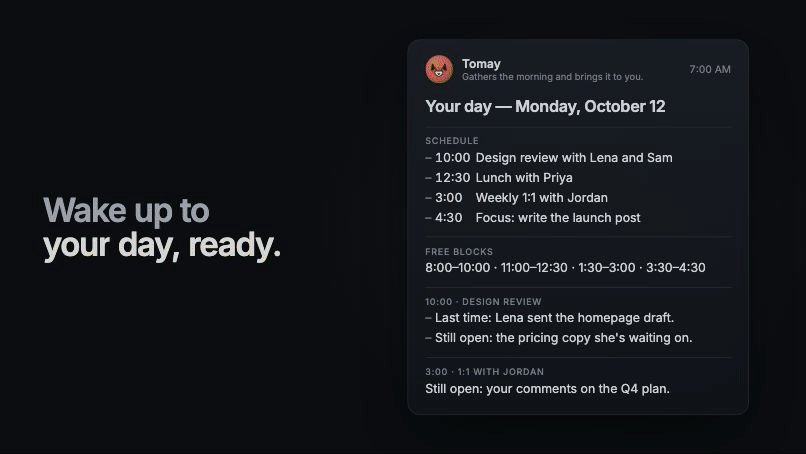
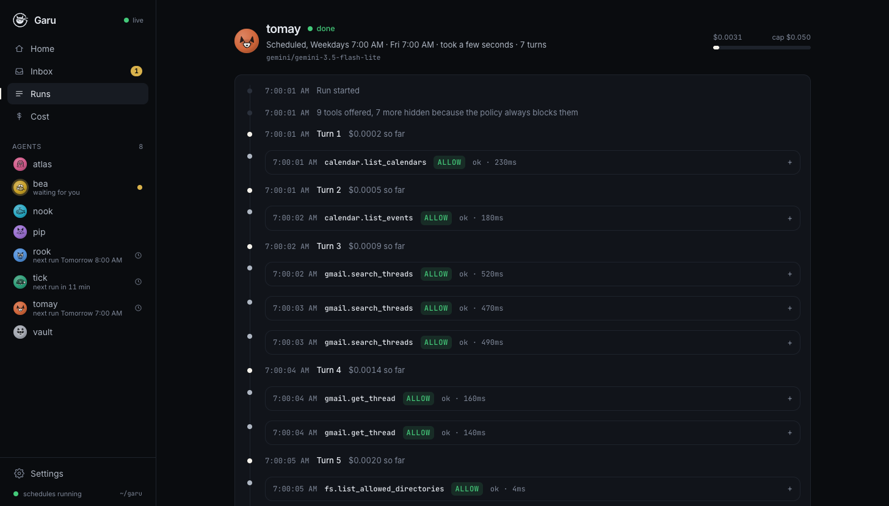
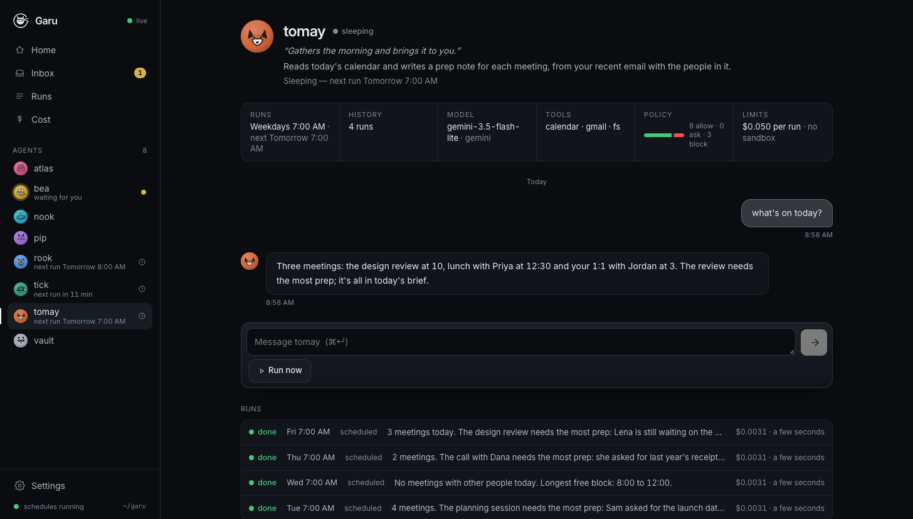
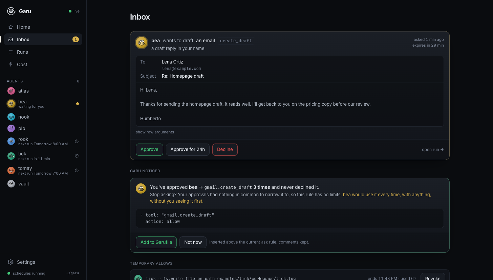

*In English: [README.md](README.md)*

<p align="center">
  
</p>
<p align="center"><sub>Del <a href="docs/video/garu-v7-16x9.mp4">video de lanzamiento de 45 segundos</a>: las reglas reales de Bea, un borrador que espera tu toque, guardado y nunca enviado. Las pantallas de la sala de control se reconstruyeron para el video; el correo es un ejemplo.</sub></p>

<p align="center"></p>

<p align="center"><strong>Agentes siempre activos en los que puedes confiar.</strong><br>
Cualquier modelo. Cualquier herramienta MCP. Cada acción pasa por una política que tú escribiste, queda registrada, con tope de gasto y aislada.</p>

<p align="center">
  <a href="https://garu-app.vercel.app/index.es.html">Sitio web</a> ·
  <a href="docs/why.md">Por qué Garu</a> ·
  <a href="#pruébalo-en-cinco-minutos-gratis">Inicio rápido</a> ·
  <a href="#cómo-funciona">Cómo funciona</a> ·
  <a href="#el-garufile">Garufile</a> ·
  <a href="#aprobaciones-que-aprenden">Aprobaciones</a> ·
  <a href="#dónde-encaja-garu">Dónde encaja Garu</a> ·
  <a href="#estado-y-hoja-de-ruta">Hoja de ruta</a>
</p>

---

OpenAI lanzó Dots y Meta lanzó Muse: agentes que corren todo el día en una computadora propia y actúan por ti. Los dos son cerrados, atados a un solo proveedor y no están disponibles en buena parte del mundo. Garu es la versión abierta, construida alrededor de la parte que ellos tratan como un detalle: el **control**.

- **Agentes que corren 24/7.** Un disparador cron en un archivo YAML pequeño, y `garu ui --up` mantiene vivo al agente. Una ejecución a la vez, cada disparo registrado, apagado limpio.
- **Un núcleo de política delante de cada herramienta.** `allow`, `ask` o `block` (permitir, preguntar o bloquear), por nombre de herramienta *y* por argumento. Las herramientas que nunca podrían pasar la política nunca se le muestran al modelo.
- **Una bandeja, no una avalancha.** Cuando una regla dice `ask`, la ejecución se pausa. Ves el correo como un correo, el archivo como un archivo. Aprueba una vez, aprueba por 24 horas o rechaza. El silencio es un no.
- **Una política que aprende, contigo al mando.** Aprueba lo mismo tres veces y Garu propone la regla exacta, limitada a lo que de verdad aprobaste, y la escribe en tu archivo cuando tú lo digas.
- **Una caja negra.** Cada turno del modelo, cada llamada a una herramienta, cada decisión y cada aprobación en un registro al que solo se agrega. Repasa cualquier ejecución como una línea de tiempo.
- **Un tope de presupuesto.** El costo se estima a partir de los tokens reales; una ejecución se detiene en el momento en que cruzaría `maxCostUsd`.
- **Un entorno aislado.** Cada servidor de herramientas en su propio contenedor de Docker: sin red, raíz de solo lectura, solo la carpeta de trabajo del agente montada, destruido al terminar la ejecución.
- **Cualquier modelo.** Gemini (nivel gratuito), Claude, o modelos locales a través de Ollama a $0. Cambia editando una línea.
- **Habla con tus agentes.** Cada agente tiene una conversación. Hazle una pregunta, dale trabajo, o solo lee lo que hizo mientras no estabas.

## Pruébalo en cinco minutos (gratis)

Necesitas Node 22+ y una clave gratuita de Gemini de [aistudio.google.com](https://aistudio.google.com) (sin tarjeta).

```sh
git clone https://github.com/humbertovillanueva/garu && cd garu
npm install && npm run build
printf 'GEMINI_API_KEY=your-key\nGARU_USER=YourName\n' > .env

npm run garu -- ui --up --as YourName       # sala de control en http://localhost:4000
```

Abre la sala de control, haz clic en **pip** en la barra lateral y pulsa **Ejecutar ahora**. Lee `examples/pip/workspace/notes.md`, se pausa para preguntar antes de escribir un resumen, y tú apruebas desde el navegador. Luego escríbele un mensaje.

¿Prefieres la terminal?

```sh
npm run garu -- validate examples/pip/Garufile.yaml
npm run garu -- run      examples/pip/Garufile.yaml   # aprueba la escritura cuando pregunte
npm run garu -- log      pip                          # repasa la caja negra
```

**Totalmente local, $0:** instala [Ollama](https://ollama.com), `ollama pull qwen3:8b` y luego `npm run garu -- run examples/nook/Garufile.yaml`.

**Tu propio agente:** `npm run garu -- new` pregunta qué debe hacer, cuándo, con qué modelo, en qué carpeta y con qué hosts, y escribe `agents/<name>/Garufile.yaml` con una política que empieza cerrada: solo las herramientas que nombraste, las escrituras preguntan primero, todo lo demás bloqueado. Luego **Ejecutar ahora** en la sala de control.

**Aislado:** con Docker corriendo, `npm run garu -- sandbox build` una vez, y luego `npm run garu -- run examples/vault/Garufile.yaml`.

**Tu día y tu bandeja:** los dos agentes en `agents/` trabajan sobre Gmail y Google Calendar. Tomay lee tu agenda cada día entre semana a las 7 y escribe una nota de preparación para cada reunión; Bea clasifica el correo del último día en cuatro etiquetas a las 7:15 y redacta respuestas que esperan por ti. Necesitan un proyecto gratuito de Google Cloud una sola vez: [docs/google.es.md](docs/google.es.md) te guía en unos quince minutos.

## Cómo funciona

```
 you ──▶ control room / CLI ──▶ agent loop ──▶ model (Gemini · Claude · Ollama)
                                     │
                                     ▼
                              policy kernel  ──▶ allow ─▶ MCP tool server (optionally in Docker)
                                     │           ask   ─▶ inbox ─▶ you (browser · CLI · phone push)
                                     │           block ─▶ never executed
                                     ▼
                              flight recorder (.garu/runs/<agent>/<run>.jsonl)
```

Un agente solo toca el mundo a través del [Model Context Protocol](https://modelcontextprotocol.io). El núcleo de política se sienta entre el modelo y cada servidor MCP. La caja negra ve todo lo que ve el núcleo. La sala de control es una vista sobre esos archivos; `garu log` también. No hay base de datos.

<p align="center"></p>

## El Garufile

Un archivo describe un agente: quién es, qué puede tocar, cuándo despierta y cuánto puede gastar. Este es uno real de este repositorio, un poco recortado: el agente que ordena la bandeja del autor cada mañana entre semana.

```yaml
name: bea
description: Sorts what arrived overnight into four labels and drafts replies to what needs one. Never sends.
persona: { kind: bee, tagline: "Sorts the inbox so you don't have to." }
model: gemini/gemini-3.5-flash-lite

triggers:
  - cron: "15 7 * * 1-5"          # entre semana a las 7:15, en tu hora local

budget:
  maxCostUsd: 0.05                # por ejecución; la ejecución se detiene si lo cruzaría

tools:
  - name: gmail                   # el servidor de Gmail de Garu: no existe herramienta para enviar ni borrar
    command: node
    args: ["packages/mcp-google/dist/index.js", "gmail"]
    auth: oauth                   # Garu inicia sesión una vez (garu auth) y le pasa un token de una hora
    oauth:
      issuer: https://accounts.google.com
      clientId: ${GOOGLE_CLIENT_ID}
      clientSecret: ${GOOGLE_CLIENT_SECRET}
      scopes: [https://www.googleapis.com/auth/gmail.modify]
      authorizationParams: { access_type: offline, prompt: consent }

policy:
  - tool: "gmail.search_threads"  # leer: siempre está bien
    action: allow
  - tool: "gmail.get_thread"
    action: allow
  - tool: "gmail.label_thread"    # clasificar: una etiqueta se quita con un clic, así que no espera
    action: allow
  - tool: "gmail.create_draft"    # las reglas ven argumentos: una respuesta a una dirección que nadie lee
    when: { to: { matches: "no-?reply|notifications?|alerts?|newsletter", ignoreCase: true } }
    action: block
    reason: a reply to an automated sender goes nowhere
  - tool: "gmail.create_draft"    # un borrador son palabras en tu nombre: ves cada uno primero
    action: ask
    reason: a draft reply in your name
  - tool: "*"
    action: block

prompt: |
  You are Bea. Sort your owner's inbox from the last day…
```

Su compañero, [Tomay](agents/tomay/Garufile.yaml), solo lee: las herramientas de lectura de agenda y correo están permitidas, su única escritura es el resumen de hoy en su propia carpeta (`fs.write_file` con `when: { path: { matches: "briefs/\\d{4}-\\d{2}-\\d{2}\\.md$" } }`), y todo lo demás está bloqueado, así que nunca se pausa.

Las reglas se evalúan de arriba abajo; gana la primera que coincide; si ninguna coincide, es `ask`, nunca un permiso silencioso. Los predicados `when` (`eq`, `matches` con `ignoreCase`, `gt`, `in`, …) te dejan permitir una herramienta para una sola ruta o un solo host y bloquearla en todo lo demás. `garu validate` revisa el archivo y te dice qué reglas son inalcanzables.

Otros campos: `sandbox:` (imagen, red, carpeta de trabajo, memoria, cpus), `modelOptions:` (ajustes del proveedor, p. ej. `think: false` en Ollama), `maxTurns:`.

### Servidores de herramientas remotos

Un servidor de herramientas puede ser una URL en vez de un comando. Garu habla el transporte Streamable HTTP de MCP, así que cualquier servidor alojado funciona: el de GitHub, el de Linear, el de Notion, el tuyo. Las claves de API vienen de `.env`; los servidores que piden inicio de sesión usan OAuth, que haces una vez en un navegador con `garu auth`.

```yaml
tools:
  - name: github
    url: https://api.githubcopilot.com/mcp/
    headers: { Authorization: "Bearer ${GITHUB_TOKEN}" }   # un PAT de permisos finos, guardado en .env
  - name: linear
    url: https://mcp.linear.app/mcp
    auth: oauth                                             # garu auth agents/x/Garufile.yaml linear

policy:
  - tool: "github.get_me"
    action: allow
  - tool: "github.get_file_contents"
    action: allow
  - tool: "github.create_issue"
    action: ask
  - tool: "*"
    action: block        # el servidor de GitHub ofrece 46 herramientas; el modelo solo ve estas tres
```

Algunos servidores no entregan un cliente OAuth propio; los servidores MCP de Workspace de Google (por ahora en vista previa para desarrolladores) quieren el tuyo, de un proyecto de Google Cloud. Nómbralo bajo `oauth:`, con el id y el secreto en `.env`, los permisos (scopes) exactos que hay que pedir (si no, un servidor puede ofrecer, y tú conceder, mucho más de lo que el agente necesita), y cualquier parámetro extra de inicio de sesión:

```yaml
  - name: calendar
    url: https://calendarmcp.googleapis.com/mcp/v1
    auth: oauth
    oauth:
      clientId: ${GOOGLE_CLIENT_ID}
      clientSecret: ${GOOGLE_CLIENT_SECRET}
      scopes: [https://www.googleapis.com/auth/calendar.events.readonly]
      authorizationParams: { access_type: offline, prompt: consent }   # para que las ejecuciones se renueven sin ti
```

Los tokens viven en `.garu/auth/` (en el gitignore), un archivo por URL de servidor, y se renuevan solos; una ejecución desatendida que necesitaría un navegador se detiene con el comando `garu auth` exacto que hay que ejecutar. Los servidores remotos corren en la máquina de alguien más, así que el aislamiento no aplica a ellos: la política es toda la frontera, y por eso importa que `block` sea lo predeterminado.

### Inicio de sesión para un servidor local

Un servidor local también puede iniciar sesión: dale `auth: oauth` y un bloque `oauth:` que diga con quién iniciar sesión (`issuer:`), como hace el servidor de Gmail de Bea arriba. `garu auth` hace el inicio de sesión una vez; Garu guarda los tokens y arranca el servidor con un token de acceso de una hora en su entorno, así que el servidor nunca tiene el secreto del cliente ni el token de renovación. Los inicios de sesión locales se archivan por emisor y permisos, así que un agente que pide Gmail de solo lectura nunca comparte un token con uno que puede escribir.

<p align="center"></p>

## Aprobaciones que aprenden

La queja de quienes usan agentes siempre activos es que *su propio* ritmo se vuelve el cuello de botella: el agente trabaja toda la noche y tú pasas la mañana haciendo clic en Aprobar. Garu trata la aprobación como el producto, no como un cuadro de diálogo.

1. **`ask` pausa la ejecución** y la petición aparece en la bandeja como lo que es: un correo con Para/Asunto/Cuerpo, un archivo con su ruta y su contenido, un comando. Al agente se le avisa que está esperando; nada más ocurre.
2. **Aprobar · Aprobar por 24 h · Rechazar.** "Por 24 h" crea un *permiso temporal*: este agente, esta herramienta, exactamente esta ruta/URL/destinatario, hasta mañana. Las peticiones idénticas que lleguen después las responde ese permiso y quedan registradas como `approved by grant …`. `garu grants` los lista y los revoca. **Rechazar puede llevar una nota** ("repo equivocado: usa humbertovillanueva/garu"): el agente la lee antes de su siguiente paso, así que un rechazo corrige la ejecución en vez de solo detener una llamada. Igual desde la terminal: `garu deny <id> --note "…"`.
3. **Reglas aprendidas.** Aprueba el mismo agente + herramienta tres veces sin ningún rechazo y Garu propone la regla más estrecha que cubre tus aprobaciones: un valor exacto, una carpeta en común, o la herramienta completa. **Agregar al Garufile** la inserta encima de la regla `ask` actual y conserva tus comentarios. **Ahora no** la oculta.
4. **Las peticiones sin respuesta expiran como un rechazo** (30 minutos de forma predeterminada). El silencio nunca significa sí.
5. **Teléfono:** `--notify https://ntfy.sh/<your-topic>` envía cada petición a la app gratuita [ntfy](https://ntfy.sh).

<p align="center"></p>

## Comandos

| Comando | Qué hace |
|---|---|
| `garu new [name]` | Crea tu propio agente: unas preguntas y luego un Garufile con una política cerrada. Flags para scripts (`--task`, `--when`, `--web`, `--fs`, `-y`). |
| `garu ui [--up] [--as Name] [--notify URL]` | La sala de control en localhost:4000. `--up` además ejecuta cada horario cron que encuentre bajo la carpeta actual. |
| `garu service install` · `status` · `logs` · `restart` · `uninstall` | Ejecuta `garu ui --up` para esta carpeta como servicio de inicio de sesión (launchd en macOS, systemd en Linux), para que un reinicio no tumbe a tus agentes. Un horario que se perdió mientras la máquina dormía o estaba apagada se ejecuta una vez cuando vuelve. `restart` después de compilar o de cambiar un horario. |
| `garu run <Garufile> [-i note]` | Ejecuta un agente una vez, aprobando en la terminal. |
| `garu up <Garufiles…>` | Ejecuta los horarios sin la interfaz; `--on-ask inbox\|deny\|allow\|terminal`. |
| `garu inbox` · `garu approve <id> [--for 24h]` · `garu deny <id>` | La bandeja desde la terminal. |
| `garu grants [list\|revoke <id>]` | Permisos temporales. |
| `garu log [agent] [run]` | Repasa una caja negra. |
| `garu validate <Garufile>` | Revisa política, cron, presupuesto y aislamiento. |
| `garu auth <Garufile> <server>` | Inicia sesión en un servidor de herramientas remoto una vez, en tu navegador. `--forget` lo elimina. |
| `garu sandbox build` | Construye la imagen de Docker predeterminada para los servidores de herramientas. |

## Dónde encaja Garu

Hay que ser claros sobre qué es esto y qué no. Dots y Muse son productos de consumo pulidos con miles de integraciones, que corren en las nubes de sus creadores con los modelos de sus creadores. OpenDots es un compañero de trabajo de código abierto, amigable, que vive en Slack y en llamadas de voz. open-multi-agent es un framework serio para orquestar equipos de agentes dentro de una empresa, con registros de auditoría a la altura.

Garu es la capa debajo de todo eso: *systemd para tus agentes*. Corre en tu laptop o en tu servidor, con cualquier modelo, incluidos los locales, y todo su diseño gira alrededor de una pregunta: **¿puedo dejar que esta cosa corra sin vigilancia con acceso de escritura a algo que me importa?** Política por argumento, reglas aprendidas de tus propias aprobaciones, un tope de costo en cada ejecución, un entorno aislado con la red apagada de forma predeterminada y una caja negra a la que no se le escapa nada. Si esa es la pregunta que te haces, este es el runtime para responderla.

## Estado y hoja de ruta

Garu tiene una semana de vida y ya ejecuta los agentes del autor todos los días. Espera bordes sin pulir. Lo que sigue, en orden:

1. **`garu install <url>`**: un registro de Garufiles que puedes instalar, bifurcar y publicar.
2. **Garu alojado:** agentes que siguen corriendo con la laptop cerrada, aprobar con un toque desde donde sea, pensado para la UE de forma predeterminada.
3. Delegación entre agentes por A2A; memoria transparente y editable.

Hecho desde el primer commit: Gmail y Google Calendar a través del servidor propio de Garu, con inicio de sesión para servidores locales; servidores MCP remotos (Streamable HTTP + OAuth), la app del teléfono por Tailscale con un token de inicio de sesión ([docs/phone.es.md](docs/phone.es.md)), la sala de control como app nativa para Android y iPhone ([docs/android.md](docs/android.md), [docs/ios.md](docs/ios.md)), `garu new`, personajes, rechazar con nota.

## Estructura

```
packages/kernel     Garufile schema · policy engine · flight recorder · MCP bus · agent loop · scheduler · inbox · grants · suggestions · sandbox · providers
packages/cli        the garu command
packages/ui         the control room (Svelte 5 + Tailwind 4)
packages/app        the control room as a native Android and iPhone app (Capacitor), pairs with a running garu ui
packages/mcp-fetch  a tiny MCP server: fetch_json / fetch_text (GET, open web only) + post_message to one webhook
packages/mcp-google Gmail and Calendar MCP server: read, label, draft; no send, no delete
agents/             real agents that run from this repo (tomay, bea, rook, atlas)
examples/           Garufiles to learn from
docker/sandbox      the default sandbox image
```

## Contribuir

Issues y PRs bienvenidos. Ejecuta `npm run typecheck && npm test` antes de abrir uno. El formato de la caja negra y el esquema del Garufile son las dos cosas que intentamos no romper.

## Licencia

Apache-2.0. Hecho por [Humberto Villanueva](https://humbertovillanueva.dev) en Salt Lake City.
